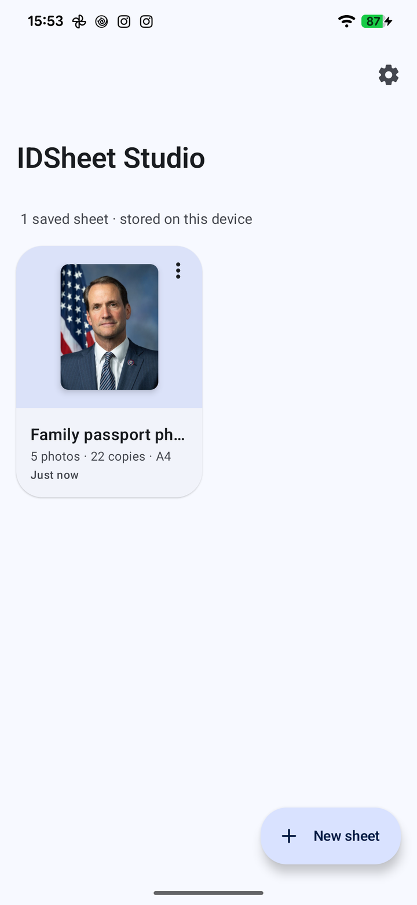
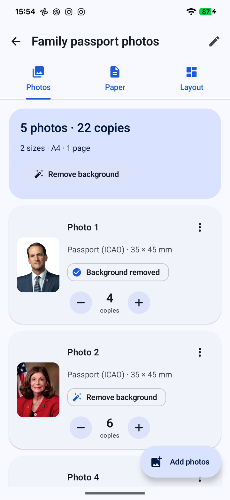
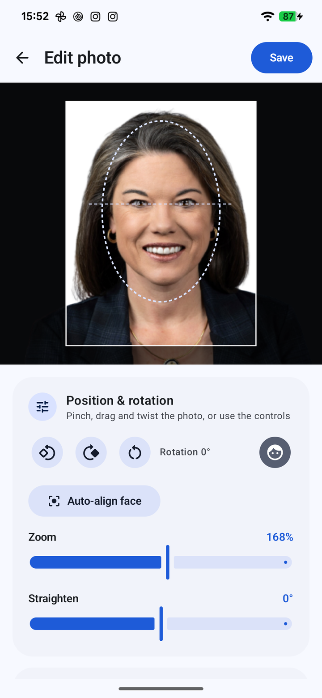
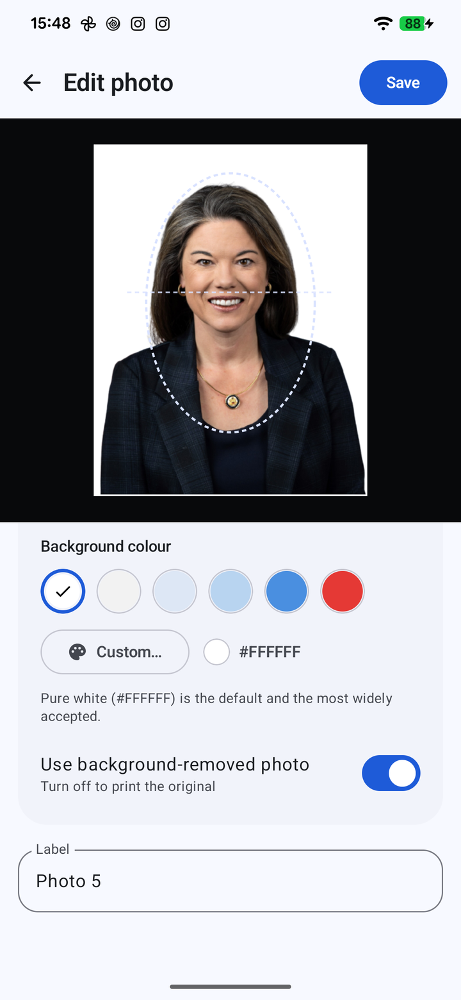
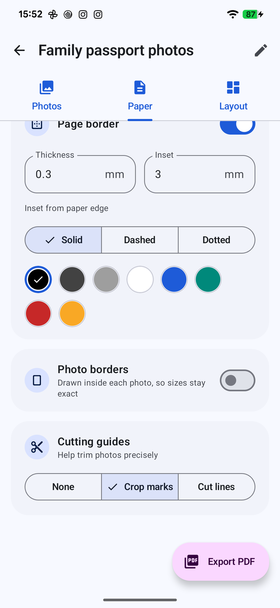
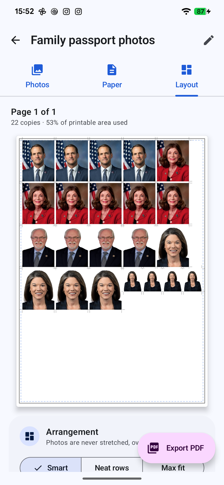
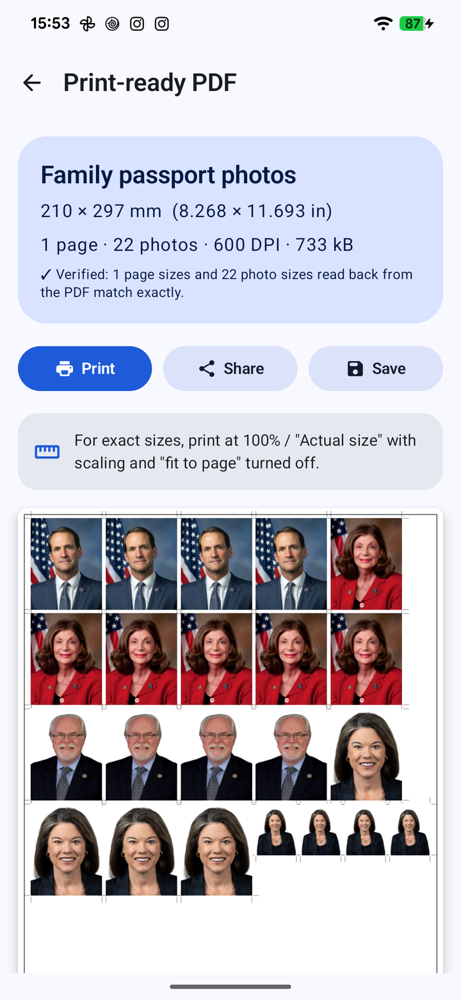
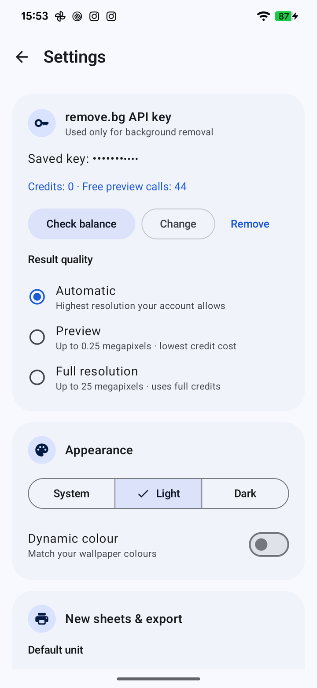
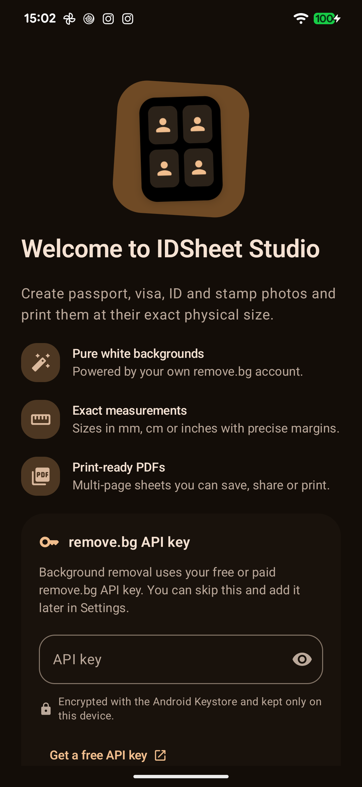

<div align="center">


# IDSheet Studio

**Free, open-source passport photo maker and ID photo sheet printer for Android.**

Remove backgrounds, crop to official sizes and print passport, visa, ID and stamp photos at their
**exact physical size** — many photos and copies arranged automatically on A4, Letter and more.

[](https://github.com/riyadmondol2006/IDSheet-Studio/actions/workflows/ci.yml)
[](https://github.com/riyadmondol2006/IDSheet-Studio/releases/latest)
[](#installation)
[](LICENSE)

[Download](#installation) · [Features](#features) · [How to use](#how-to-use) · [FAQ](#faq) · [Changelog](CHANGELOG.md)

</div>

---

## Screenshots

<table>
  <tr>
    <td align="center"><br/><sub>Saved sheets</sub></td>
    <td align="center"><br/><sub>Photos & copies</sub></td>
    <td align="center"><br/><sub>Crop & rotate</sub></td>
    <td align="center"><br/><sub>White background</sub></td>
  </tr>
  <tr>
    <td align="center"><br/><sub>Paper & borders</sub></td>
    <td align="center"><br/><sub>Smart layout</sub></td>
    <td align="center"><br/><sub>Print-ready PDF</sub></td>
    <td align="center"><br/><sub>Settings</sub></td>
  </tr>
  <tr>
    <td align="center"><br/><sub>Dark mode · Material You</sub></td>
  </tr>
</table>

<sub>Screenshots taken on a Pixel 6 Pro (Android 17).</sub>

## Features

### 📸 Photo editing
- Import **several photos at once** from the Android photo picker (JPEG, PNG, WebP, HEIC).
- **Remove backgrounds** with your own [remove.bg](https://www.remove.bg/api) API key and replace
  them with **pure white** (#FFFFFF) or another colour.
- **Crop, zoom, reposition and rotate** with pinch, drag and twist gestures, 90° buttons and a
  straighten slider. A **face guide** helps place the head and eyes, and **Auto-align face**
  (on-device face detection, nothing uploaded) centres and sizes the face for you.
- After removing the background pick **pure white or any colour** — presets or a custom
  hex/RGB colour.
- EXIF orientation is handled automatically, so phone photos are always upright.

### 📏 Exact photo sizes
- 28 presets: **passport** (ICAO 35 × 45 mm, US 2 × 2 in, Canada 50 × 70 mm, China 33 × 48 mm),
  **visa** (US, Schengen, India, China), **ID** (1 inch, 2 inch, 30 × 40 mm, 4 × 6 cm),
  **stamp** sizes and **country presets** (UK, EU, India, Bangladesh, Pakistan, Australia, Japan,
  Malaysia, Brazil, Indonesia and more).
- **Fully custom sizes** in millimetres, centimetres or inches.
- Every photo has its **own size and number of copies**, and one portrait can be added in
  **several sizes on the same page** (e.g. 4 passport + 6 stamp copies) with *Add another size*.

### 🧾 Paper & layout
- **A4, A5, Letter, Legal, 4 × 6 in, 5 × 7 in** or any custom paper size, portrait or landscape.
- Exact **margins** (all sides or each side) and **spacing** between photos.
- Optional **page border** and **photo borders** with adjustable thickness, colour, style
  (solid, dashed, dotted) and inset. Borders are drawn inside each photo, so sizes stay exact.
- **Smart layout** arranges different sizes and quantities across as many pages as needed —
  never stretched, never overlapping, never dropping a copy. Choose tidy rows (easiest to cut)
  or maximum fit, or let the app pick; optionally rotate photos to fit more.
- **Auto-align** the photos on each page: left, centre or right; top, middle or bottom; or
  **spread evenly** with equal gaps.
- **Drag photos by hand** (long-press on the page); invalid moves are rejected.
- **Crop marks** or **cut lines** for precise trimming.

### 🖨️ Print-ready PDF
- Multi-page PDF with **exact fractional page sizes** (A4 is 595.276 × 841.890 pt, not rounded)
  and photos embedded at **300, 450 or 600 DPI**.
- After every export the app **reads the PDF back** and verifies every page size and photo size.
- **Preview**, **share**, **save** anywhere, or **print** with Android's print framework.

### 💾 Projects & privacy
- Sheets are saved automatically and work **fully offline** after background removal:
  reopen, edit, rename, **duplicate**, delete and export any time.
- Photos stay on your device. They are only uploaded to remove.bg when you ask for it.
- The API key is encrypted with the **Android Keystore**.

### ✨ Modern Android
- **Material 3** design with **dynamic colour** (Material You), **dark mode** and expressive,
  spring-based motion.
- **Automatic updates:** when a new version is published on GitHub, IDSheet Studio shows an
  update popup with the changelog and *Update*, *Later* (remind me tomorrow) and *Skip version*.
  It checks whenever you open the app and every few hours in the background, posting a
  notification you can tap to update. Updates are verified (SHA-256, package name, version,
  signing certificate) before the Android installer asks you to confirm.

## Installation

1. Open the [latest release](https://github.com/riyadmondol2006/IDSheet-Studio/releases/latest)
   on your phone and download `IDSheet-Studio-vX.Y.Z.apk`.
2. Open the file. If Android asks, allow your browser or file manager to **install unknown apps**.
3. Tap **Install**, then open **IDSheet Studio**.

**Requirements:** Android 8.0 (API 26) or newer.

**Verify the download (optional):** every release lists the APK's SHA-256 checksum and signing
certificate, and ships a `.sha256` file:

```bash
sha256sum -c IDSheet-Studio-vX.Y.Z.apk.sha256
apksigner verify --print-certs IDSheet-Studio-vX.Y.Z.apk
```

**Updates:** you only install once. When a new release is published, the app shows an update
popup the next time you open it (and a notification from its background check). Tap **Update**,
confirm the Android prompt, done. Automatic checks can be turned off, and you can check manually,
in **Settings → Updates**.

> Debug builds from CI (`IDSheet-Studio-debug-*.apk`) install as a separate app named
> "IDSheet Studio (Debug)" and are meant for testing.

## Getting a remove.bg API key

Background removal is optional and uses your own remove.bg account:

1. Sign up at [remove.bg](https://www.remove.bg/users/sign_up) (free accounts include free API calls
   at preview resolution).
2. Open the [API key page](https://www.remove.bg/dashboard#api-key) and create a key.
3. Paste it into IDSheet Studio on first launch, or later in **Settings → remove.bg API key**.
   The app checks the key (this doesn't use credits) and shows your balance.

Choose the result quality in Settings: *Preview* (up to 0.25 MP, cheapest), *Full* (up to 25 MP) or
*Automatic*.

## How to use

1. **New sheet** → **Add photos** and pick one or more portraits.
2. Tap a photo to **crop**, choose its **size preset**, the **number of copies**, and
   **remove the background**.
3. In **Paper**, choose the paper, orientation, margins, spacing, borders and cutting guides.
4. In **Layout**, check the pages. Long-press and drag a photo to move it.
5. Tap **Export PDF**, then **Print**, **Share** or **Save**.

### Printing at the correct size

- Print at **100 % / Actual size**. Turn off *Fit to page*, *Scale to fit* and borderless
  enlargement. The PDF asks viewers not to scale (`/PrintScaling /None`), but some print dialogs
  ignore that.
- Select the same paper size in the print dialog as in the app.
- Check the first print with a ruler: a 35 × 45 mm photo should measure exactly that.

## FAQ

<details>
<summary><b>Is IDSheet Studio free?</b></summary>

Yes. The app is free and open source (MIT). Background removal uses your own remove.bg account,
which has free and paid tiers.
</details>

<details>
<summary><b>Do I need a remove.bg key?</b></summary>

No. Everything else — cropping, sizes, layout, PDF and printing — works without one. You can skip
the key during setup and add it later.
</details>

<details>
<summary><b>Will my printed photos be exactly the right size?</b></summary>

The PDF stores exact physical measurements and the app verifies them after every export. The
printed size then depends on your printer settings: print at 100 % / Actual size with scaling
turned off. Printers have their own small tolerances, so measure a test print.
</details>

<details>
<summary><b>Are the size presets official?</b></summary>

They follow the commonly published requirements, but rules change and some countries also
specify head size, background or expression. Always confirm with the issuing authority. You can
enter any custom size.
</details>

<details>
<summary><b>Where are my photos stored? Does the app work offline?</b></summary>

All photos and sheets are stored in the app's private storage on your device. After backgrounds
are removed, everything works offline. Photos are uploaded to remove.bg only when you tap
*Remove background*, and are never sent anywhere else.
</details>

<details>
<summary><b>How many photos fit on one A4 page?</b></summary>

With 5 mm margins and 2 mm spacing, 30 passport photos (35 × 45 mm) fit on A4 portrait. The app
calculates this for any combination of sizes and fills extra pages automatically.
</details>

<details>
<summary><b>Why does the app ask to install apps?</b></summary>

Only for in-app updates from GitHub Releases. Every update is checked against this app's signing
certificate and the published checksum, and Android always asks you to confirm.
</details>

## Building from source

Requirements: JDK 21 and the Android SDK (platform 37, build-tools 37.0.0), or Android Studio.

```bash
git clone https://github.com/riyadmondol2006/IDSheet-Studio.git
cd IDSheet-Studio
./gradlew assembleDebug              # app/build/outputs/apk/debug/app-debug.apk
./gradlew lintDebug testDebugUnitTest
./gradlew connectedDebugAndroidTest  # needs a device or emulator
```

Release builds are signed only in CI, from repository secrets. See
[CONTRIBUTING.md](CONTRIBUTING.md) for the architecture, tests and release process.

**Tech stack:** Kotlin · Jetpack Compose · Material 3 · MVVM · Room · DataStore · Retrofit ·
OkHttp · Kotlin Coroutines & Flow · kotlinx.serialization · Navigation Compose · Gradle Kotlin DSL.

## Contributing

Contributions are welcome — see [CONTRIBUTING.md](CONTRIBUTING.md). Report security issues as
described in [SECURITY.md](SECURITY.md).

## License

IDSheet Studio is released under the [MIT License](LICENSE).

Sample portraits in the screenshots are official US Congress portraits, which are in the public
domain (via [Wikimedia Commons](https://commons.wikimedia.org/)). IDSheet Studio is not affiliated
with remove.bg or any government agency.
